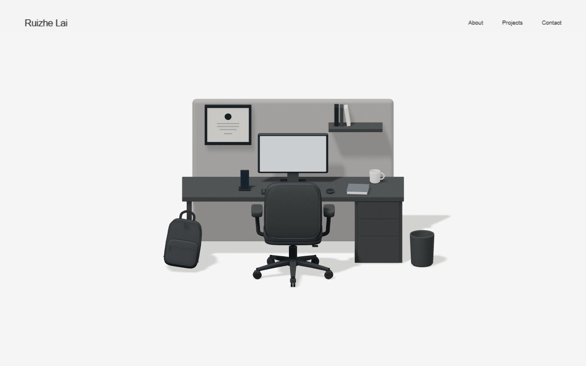

# Ruizhe Lai — Personal Website

A minimal portfolio built with Next.js App Router, React, TypeScript, Tailwind CSS,
Three.js, React Three Fiber and Drei. The homepage uses the existing Blender
workspace as a small, interactive 3D hero.



## Develop locally

The active Windows checkout is `E:\Personal Website`. Node.js 24.18.0 and npm
11.16.0 were used for verification. Dependency versions are pinned in `package.json`
and `package-lock.json`.

```powershell
Set-Location -LiteralPath 'E:\Personal Website'
npm ci
npm run dev
```

Open [http://127.0.0.1:3000](http://127.0.0.1:3000).

```powershell
npm run check:model
npm run typecheck
npm run build
npm start
```

`npm start` serves the production build; stop an existing dev server first if it
already occupies port 3000. `predev` and `prebuild` synchronize the GLB and fallback
render into `public/`, verifying their hashes without editing the original assets.

## Routes and interactions

- `/`: fixed orthographic camera, damped wheel zoom (0.9–1.7×), chair tracking up
  to ±18°, restrained hover highlights, focus-only tooltips and 3D object navigation.
- `/about`: clearly marked introductory/background/experience/education placeholders.
- `/projects`: responsive placeholders for WillDo, MenuLab, FixLens and Sippy.
- `/contact`: contact placeholders and the verified GitHub profile link.

Wall frame → About, monitor → Projects, smartphone → Contact. The same actions
are keyboard accessible. The backpack, mug and trash bin remain static. There are
no plants, orbit controls, free camera movement or additional hero copy.

## Project map

- `app/`: App Router pages, shared layout and global styling.
- `components/layout/`: header and shared content page layout.
- `components/workspace/`: model loading, fixed camera, chair damping, raycasting,
  projected DOM accessibility controls and fallback/error handling.
- `lib/workspace-config.ts`: initial framing, zoom limits, damping and object routes.
- `scripts/sync-assets.mjs`: source-preserving web asset copying and node/pivot audit.
- `public/`: only the model and saved render required for web serving.
- `workspace/`: preserved Blender files, models, modeling scripts and references.
- `docs/PHASE_1.md`: implementation details, validation results and known limits.

The model is not rebuilt. Web material instances are cloned for reversible hover
feedback. The existing floor gets a neutral web-only studio fill and a transparent
shadow layer reusing its geometry; original files remain unchanged.

## 3D source documentation

- [Workspace v2: chair and backpack](workspace/WORKSPACE_V2.md)
- [Original workspace baseline](workspace/README.md)
- [Web model hierarchy/pivot audit](workspace/reports/web_model_audit.json)
- [Browser and build verification](docs/phase-1-validation.json)
