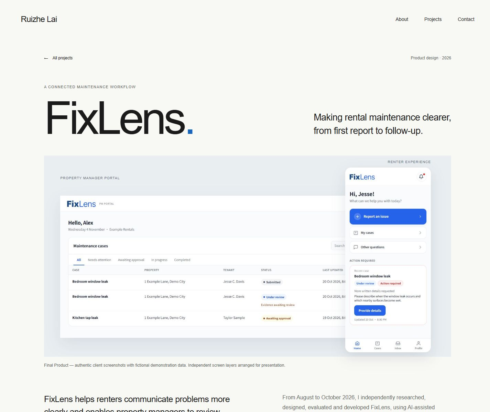
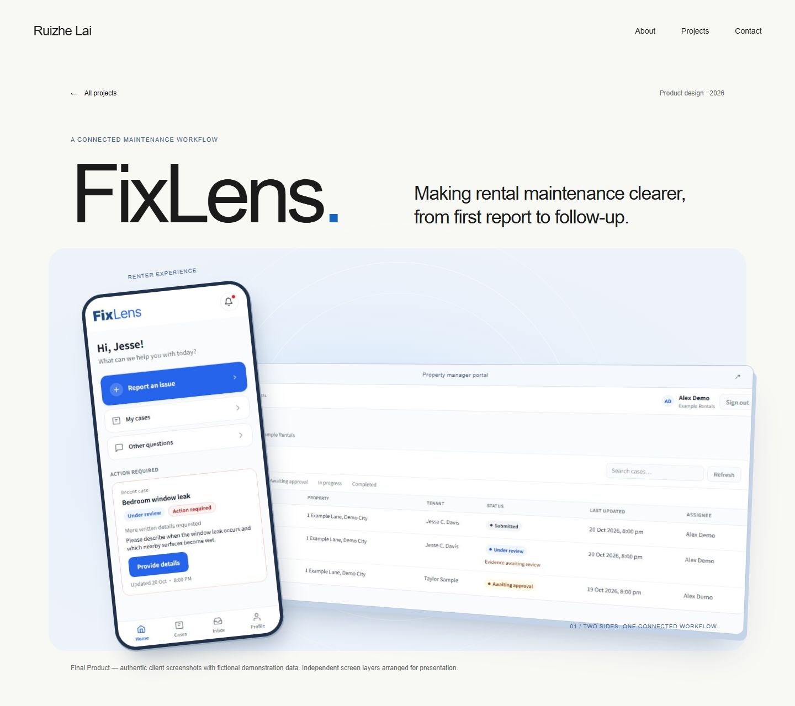

# Phase 3B — Local visual review

5 November 2026 · Review branch: `codex/fixlens-phase-3b-visual-review`

This is the requested first review of **Hero, Design Evolution and Final Solution**. The stable implementation remains on `main` at `0d17c079f45a7f115422bd8316d338af1d818f45`. No branch has been pushed, merged or publicly deployed during Phase 3B.

## Preview

The local production review is available at:

**http://127.0.0.1:3010/projects/fixlens**

It uses the existing route on the review branch. The preview is already running; no restart is necessary. After stopping that process, restart from PowerShell with:

```powershell
Set-Location -LiteralPath 'E:\Personal Website'
npm run build
npm run start -- --port 3010
```

For live editing, use `npm run dev -- --port 3010` after stopping the production preview. Use the current review branch when rebuilding.

## Reference analysis and decisions

[PHASE_3B_VISUAL_DIRECTION.md](PHASE_3B_VISUAL_DIRECTION.md) was written before implementation. All three supplied Behance references were viewed as actual browser imagery. The web text reader failed, but browser access succeeded. No reference assets were downloaded or copied.

The review adapts:
- BaseCase's dominant product scenes and controlled changes of scale.
- Niva's interface-led storytelling, with supporting details around a complete screen.
- VELORA's blue environment and staggered product presentation.

Existing website typography and FixLens identity remain. The rest of the case study keeps its existing layout and styling.

| Area | Original Phase 3A | Phase 3B review |
| --- | --- | --- |
| Hero | Flat dashboard and smaller overlaid tenant screenshot | Larger independent tenant device, broad framed dashboard, subtle perspective and a soft blue environment |
| Design evolution | Repeated static fidelity columns | One focused workspace with topic and fidelity selection; a large active artifact and optional all-stage comparison |
| Guided reporting solution | Text beside an even phone pair | Full-width scene with staggered screens and explicit visual progression |
| Capture / recovery | Repeated text-and-pair row | Asymmetrical recovery and safety composition with distinct image scales |
| Follow-up | Repeated pair plus a separate wide detail | Tenant Home, status detail and retained response composed as one connected story |
| PM workflow | Flat wide screenshot and supporting row | Broad browser composition followed by a focused request dialog and explanatory copy |

## Before / after visual comparison

The paired views use the exact original screenshots already captured in Phase 3A.

| Section | Before | Review version |
| --- | --- | --- |
| Hero | [Original hero](screenshots/phase-3a/01-hero-desktop.jpg) | [Redesigned hero](screenshots/phase-3b/01-hero-desktop.jpg) |
| Evolution | [Original three-stage layout](screenshots/phase-3a/04-evolution-desktop.jpg) | [Focused workspace](screenshots/phase-3b/02-evolution-desktop.jpg) · [All-stage comparison](screenshots/phase-3b/02b-evolution-comparison-desktop.jpg) |
| Solution | [Original first feature](screenshots/phase-3a/05-solution-desktop.jpg) | [Reporting scene](screenshots/phase-3b/04-solution-guided-desktop.jpg) · [Follow-up scene](screenshots/phase-3b/06-solution-followup-desktop.jpg) |
| Whole page | [Original full page](screenshots/phase-3a/09-full-desktop.jpg) | [Review full page](screenshots/phase-3b/08-full-page-desktop.jpg) |
| Mobile hero | [Original mobile](screenshots/phase-3a/08-mobile-390.jpg) | [Review mobile](screenshots/phase-3b/09-hero-mobile.jpg) |

| Original hero | Redesigned hero |
| --- | --- |
|  |  |

## Content and evidence preservation

An automated source/asset comparison passed:

- All **six non-target sections** are exact source matches: Challenge, Research, Low-fi Exploration, Evaluation, Iteration and Reflection.
- All **64 original paragraphs**, **19 original captions** and **14 original stage labels** remain.
- Hero role, timeline, platform and outcome markup is unchanged.
- The original base `fixlens.css` is unchanged; art direction is added in two scoped stylesheets.
- All **31 published WebP files** retain their recorded SHA256 hashes. No public images were added, removed or edited.
- Held FX23, FX24 and FX34 remain excluded. No reference images, raw participant data, fabricated UI or recreated reporting screens were introduced.
- The eight available fidelity artifacts are the existing Home (three), Capture (two) and Tracking (three) assets.
- The six reporting states remain in their original sequence, with danger and safe paths shown as alternatives.
- All prototype/product distinctions, evaluation metrics, no-retest caveat, implementation limits and original image captions remain.

The three evolution topic explanations are moved into the selector verbatim. Their full static content remains in server HTML.

## Interaction design

The evolution workspace uses semantic topic and fidelity tabs with roving keyboard focus and labelled panels. Home, End and arrow keys select stages/topics. A pressed-state “Show all stages” control exposes comparison mode. No autoplay, invented screen states or simulated product actions are used.

All topics and stages are visible in server rendering. Enhancement hides inactive panels only after hydration; without JavaScript, the document shows every artifact. The existing image links and native horizontal reporting gallery remain available.

The active-artifact transition is a short fade/8px translation. Hero depth changes are small hover/focus movements on larger pointer-capable layouts. Small screens remain still. Reduced-motion CSS removes these transitions, rotations and animations. The existing parent observer also respects the motion preference.

Device and browser frames are CSS presentation layers. The original images, intrinsic aspect ratios, source alt text and lightbox access are retained. No fake status bar, camera cutout, video placeholder or clickable product control was added.

## Responsive review

The desktop uses larger product compositions. Tablet layouts simplify perspective and avoid overlap over essential phone UI. Mobile stacks the feature screens, keeps the active evolution image around 279–288px wide and exposes explicit stage controls.

Final production browser checks:

| Viewport width | Document client / scroll width | Page overflow | Follow-up image overlap |
| --- | --- | --- | --- |
| 1440 | 1425 / 1425 | None | None |
| 1024 | 1009 / 1009 | None | None |
| 768 | 753 / 753 | None | None |
| 390 | 375 / 375 | None | None |
| 375 | 360 / 360 | None | None |

The 15px difference is the scrollbar. The reporting gallery retains intentional internal scrolling.

## Validation

| Check | Result |
| --- | --- |
| TypeScript / route generation | Passed on final source |
| Production build | Passed; existing routes and /projects/fixlens prerendered |
| Existing backpack / trash interaction checks | Passed |
| Existing model audit | Passed; unchanged 205-node GLB and source hash |
| Content and image-hash preservation | Passed, as detailed above |
| Evolution stages | All eight topic/fidelity combinations opened the correct genuine artifact |
| Capture fidelity history | Exactly two stages; no unsupported Hi-fi stage |
| Keyboard topic/stage navigation | ArrowRight and Home/End exercised; focus followed selection |
| All-stage mode | Two-stage Capture and three-stage Home comparison exercised |
| ARIA controls | No missing aria-controls target IDs |
| Image lightbox | Enter opened; close button received focus; Escape closed and restored image-link focus |
| Responsive layouts | Five widths passed, with no page overflow or essential follow-up image overlap |
| Complete desktop scroll | All reveal targets visible; no broken or incomplete visible images |
| Image loading | Two hero layers eager/high priority; offscreen artifacts remain lazy |
| Final production case-study console | No warnings or errors |
| Existing routes / homepage | Projects links in both directions and ready 3D canvas confirmed |
| Server-rendered fallback | 35 image links and all eight fidelity artifacts present; no enhanced/hiding class in server HTML |
| Lint | No lint configuration/script exists; not run |

The initial development preview emitted Next.js's hero-image LCP advisory. The final implementation follows the installed Next.js 16.4.3 image guidance with eager loading and high fetch priority for the two hero layers. There is no claim of a measured Lighthouse or LCP score.

**Limits:** Reduced motion and no-JavaScript behavior were inspected through CSS/React source and server HTML; browser media emulation and a scripting-disabled browser run were not available. No automated accessibility scanner, physical-device touch test or quantitative layout-shift audit was run. This phase does not evaluate FixLens product usability.

## Screenshots

Under `docs/screenshots/phase-3b/`:

- 01-hero-desktop.jpg
- 02-evolution-desktop.jpg
- 02b-evolution-comparison-desktop.jpg
- 03-solution-full-desktop.jpg
- 04-solution-guided-desktop.jpg
- 05-solution-recovery-desktop.jpg
- 06-solution-followup-desktop.jpg
- 07-solution-manager-desktop.jpg
- 08-full-page-desktop.jpg
- 09-hero-mobile.jpg
- 10-evolution-mobile.jpg
- 11-solution-full-mobile.jpg
- 12-solution-guided-mobile.jpg
- 13-solution-followup-mobile.jpg
- width-1024.jpg, width-768.jpg, width-375.jpg

The complete solution captures show all four feature stories; the full desktop image includes all nine sections. Screenshot files are documentation artifacts, outside the public asset directory.

## Files changed

- `app/projects/fixlens/page.tsx`: recompose the three review sections; preserve verified copy.
- `app/projects/fixlens/fixlens-art-direction.css`: scoped Hero, Evolution environment and four solution compositions.
- `app/projects/fixlens/evolution-studio.css`: responsive selector, active artifact and comparison treatment.
- `components/fixlens/EvolutionStudio.tsx`: progressive, keyboard-accessible fidelity presentation.
- `components/fixlens/CaseStudyExperience.tsx`: two-line priority-image loading correction; existing modal/gallery logic unchanged.
- `docs/PHASE_3B_VISUAL_DIRECTION.md`: pre-implementation reference analysis.
- `docs/PHASE_3B_REVIEW.md`: this comparison and validation record.
- `docs/phase-3b-validation.json`: structured preservation and viewport checks.
- `docs/screenshots/phase-3b/`: review captures.

No dependencies, homepage source, models, Projects page, other routes, original UX files or deployed FixLens application files were changed. The pre-existing local `next-env.d.ts` modification was backed up and restored, and is not part of the redesign commit.

## Review gate

The three requested sections are ready for visual review. Approve or adjust this direction before applying it to the remaining sections or merging/pushing to main. The review branch and local screenshots preserve a concrete version for comparison.
