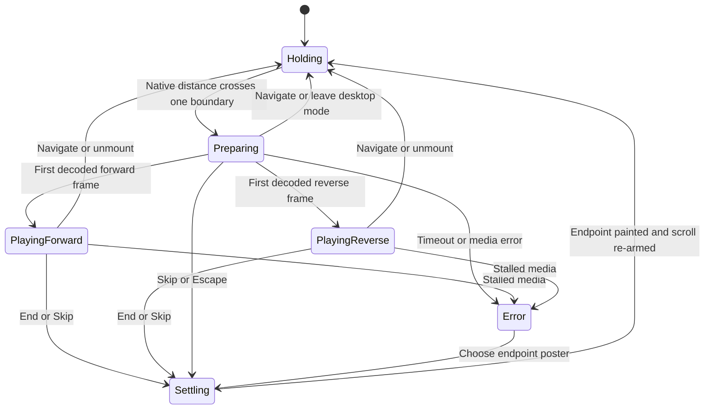

# Phase 5L cinematic timeline

Each interval is in viewport heights from Home. On forward movement the first crossed start triggers at start plus 0.008. On reverse movement the first crossed end triggers at end minus 0.008. The controller pins the document 0.022 viewport heights outside the interval on the departure side. After the action paints its endpoint, it moves the native scroll anchor 0.022 viewport heights outside the other end. Contact is clamped to the actual bottom of the document. The distance between actions is ordinary reading and interaction space.

| Stage | Scroll interval | Source frames at 24 fps | Source times | Native length | Forward hold | Camera, portal and copy |
| --- | --- | --- | --- | ---: | --- | --- |
| Entrance | 0.26–1.67 | Clip 1, 0–120 | 0.000–5.000 s | 5.042 s | Inside the portrait | Approach with the figure as it wakes and reaches. Frame 66 begins the pull. The portal opens as the source frame disappears. |
| Arrival | 1.94–2.85 | Clip 2, 0–120 | 0.000–5.000 s | 5.042 s | Standing introduction | Full About stage. Introduction appears after the figure recovers. |
| Design | 3.70–4.14 | Clip 3, 0–48 | 0.000–2.000 s | 2.042 s | Drawing at the easel | Full stage. Education replaces Introduction near the landing. |
| Technology | 4.80–5.34 | Clip 3, 48–120 | 2.000–5.000 s | 3.042 s | Laptop and phone | Education remains in place; the technology line enters near its pose. |
| Problem | 6.06–6.35 | Clip 4, 0–42 | 0.000–1.750 s | 1.792 s | Understanding the Problem | Switch to the Capabilities heading and first entry near the landing. |
| Research | 6.94–7.24 | Clip 4, 42–90 | 1.750–3.750 s | 2.042 s | Research the People | Retain Capability 01 and reveal Capability 02. |
| Interface | 7.83–8.14 | Clip 4, 90–146 | 3.750–6.083 s | 2.375 s | Design the Experience | Retain the first two entries and reveal Capability 03. |
| Build | 8.72–9.08 | Clip 4, 146–205 | 6.083–8.542 s | 2.500 s | Build & Iterate | All four entries remain in the final overview. |
| Sports | 9.97–11.00 | Clip 5, 0–115 | 0.000–4.792 s | 4.833 s | Chelsea jersey and sports equipment | One continuous action joins the outfit change and equipment reveal. Beyond Work enters with the relaxed pose. |
| Return | 11.57–13.24 | Clip 5, 115–216 | 4.792–9.000 s | 4.250 s | Framed Chelsea portrait at the desk | Fade the interests as the border reforms and the camera returns to the physical frame. |
| Monitor in | 13.92–14.74 | Camera only | — | 1.000 s | Projects | Move the camera and open the monitor portal on one clock. |
| Monitor out | 16.60–17.36 | Camera only | — | 0.850 s | Interactive workspace | Close the monitor portal and return to the desk. |
| Phone in | 18.04–18.84 | Camera only | — | 0.950 s | Contact | Move the camera and open the phone portal on one clock. |

Source intervals are inclusive. Entrance and Sports use newly joined H.264 cuts in `public/images/phase5l`; the remaining actions use the existing exact-phase derivatives in `public/images/phase5i`. Both encode groups contain silent forward and reverse files at 768 × 768 and 24 fps. Hold images are the matching WebP endpoints from the original clips. Home uses clip 1 frame 0. Reverse actions play physically reversed MP4s at positive speed and return to the prior reading or desk hold. At a source-clip boundary the reverse endpoint can include the original editorial cut between poses.

The media clock drives position, camera, portal and copy together. The camera keeps a bounded lead of at most one source frame beyond the most recent decoded frame. Waiting freezes the interpolation at the last decoded time. For clips with a new chapter, the old chapter fades over the first 24% and the new chapter enters over the last 24%. Within a chapter the preceding entries stay visible and the incoming line appears at about 79% of the action. The same cues run backward on reverse. The two workspace holds and all reading holds remain untimed.

Camera-only transitions go from Preparing directly into the direction state using a requestAnimationFrame clock. Their endpoints activate Projects or Contact only after release. Direct navigation lands on the destination hold and cancels any active action.
